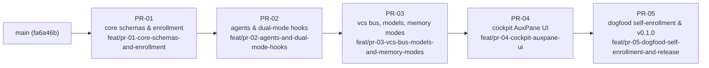

# principal-architect-plugin — Programme Plan

Companion to [`PROGRAM.md`](PROGRAM.md). This file holds the operational plan: the PR dependency graph, branch conventions, the per-PR execution and audit protocol, **indicative Work Order shapes per PR** (guidance for each Tier 2 PA — the PA owns the actual decomposition), human tasks, environment constraints, programme decisions, the risk register, and the live status tracker. The Chief Architect updates it at every programme-level transition.

## 1. Stacked PR Dependency Graph



| PR | Slug | Base (branch name) | Depends on | Verification floor | Primary SPEC sections |
|---|---|---|---|---|---|
| PR-01 | `pr-01-core-schemas-and-enrollment` | `main` | — | `pytest tests/test_schemas.py tests/test_state_db_and_sync.py` | §4, §6, §8 (`enroll`, `unenroll`, `status`, `mode`) |
| PR-02 | `pr-02-agents-and-dual-mode-hooks` | `feat/pr-01-core-schemas-and-enrollment` | PR-01 | `pytest tests/test_hooks_monitored_vs_autonomous.py` | §5.2, §7, §8 (`pr approve-plan`, `wo verify`, `escalate`), §11 |
| PR-03 | `pr-03-vcs-bus-models-and-memory-modes` | `feat/pr-02-agents-and-dual-mode-hooks` | PR-02 | `pytest tests/test_github_and_local_git_bus.py tests/test_memory_modes.py` | §5.3, §8 (remaining lifecycle commands), §9 |
| PR-04 | `pr-04-cockpit-auxpane-ui` | `feat/pr-03-vcs-bus-models-and-memory-modes` | PR-03 | `pytest tests/test_cockpit_api.py` + live AuxPane verification (interactive WO) | §10 |
| PR-05 | `pr-05-dogfood-self-enrollment-and-release` | `feat/pr-04-cockpit-auxpane-ui` | PR-04 | full suite + `pa status --json` consistency check | — (programme-level) |

Execution is **serial**: a PR's Tier 2 PA is spawned only after the upstream PR has graduated (Step 6B complete) and its Charter has been refined just-in-time against the upstream PR's final exported interfaces. Every PR must keep **all upstream floors** green.

## 2. Branch & Integration Conventions

1. **Work Order branches stack linearly** inside a PR: `pr-NN-<slug>/wo1-<topic>` bases on the PR's `base_branch`; `woM` bases on `wo(M-1)`. Bases are always **branch names**, never SHAs (`STACKING_REFERENCE.md` §1.2).
2. **Integration tip per PR:** at Step 6A the PA creates or fast-forwards `feat/pr-NN-<slug>` to the final WO branch (`git branch -f feat/pr-NN-<slug> pr-NN-<slug>/woM-<topic>`), pushes it, and opens the GitHub PR with `--head feat/pr-NN-<slug>`. Remediation commits land on the tip WO branch (or a stacked `wo(M+1)-review-remediation`) and `feat/pr-NN-<slug>` is re-fast-forwarded and pushed. The `feat/` name never changes (immutable-head rule) and is what downstream PRs base on.
3. **Restacking:** when an upstream PR is amended after a downstream PR has started, the downstream PA runs `git rebase --update-refs` (or `pa pr restack` once PR-03 lands) from its WO1 onto the new upstream tip, then force-pushes its `feat/` branch.
4. **Archiving:** abandoned branches are renamed `archive/<original-name>`.
5. **Merging to `main`:** bottom-up only. `main` is advanced by merging `feat/pr-01-…` first (merge commit or fast-forward; never squash a middle-stack branch into its parent), then `gh pr edit <N> --base main` / restack the next PR.

## 3. Per-PR Execution, Audit & Graduation Protocol

```
Chief (Tier 1)
 ├─ 0. JIT Charter: refine & lock Part I of pr-NN/PROJECT.md; stamp charter_hash; commit on the base branch
 ├─ 1. Spawn Tier 2 PA for PR-NN (invoke_subagent: TypeName self, Model inherit, Workspace inherit;
 │     bridge prompt: Charter, PROGRAM.md, SPEC sections, constraints)
 │     PA: file-level discovery → Part II (WO breakdown) → reports decomposition to Chief
 ├─ 2. Human reviews Part II in the Chief session → approval recorded in PROJECT.md
 │     (status: APPROVED, approved_at, and a dated "decomposition approved by user" status-log line)
 │     PA: creates WO branches, writes each WORKORDER.md, spawns exactly 1 Tier 3 Worker per WO (serially,
 │         Workspace "inherit", Model mapped from `complexity`), re-ingests each Completion Report
 ├─ 3. Step 6A: PA fast-forwards feat/pr-NN-<slug>, pushes, opens the GitHub PR (Torvalds Standard body),
 │     reports {pr_number, pr_url, feat_branch, tip_wo_branch, head_sha} to Chief and PAUSES (no graduation)
 ├─ 4. Spawn Tier 2b Cold-Firewall Auditor (Model inherit, Workspace inherit, read-only working tree)
 │     Input: PR id + head_sha, SPEC.md, docs/, PROGRAM.md, PROJECT.md Part I/II, WORKORDER.md files
 │     Review: `gh pr diff <N>` (or `git diff <base_branch>...feat/pr-NN-<slug>`), run the verification
 │             floor(s), check I1–I11 incl. the I10 hygiene search; 5 axes: spec_alignment, invariants,
 │             edge_cases, test_quality, scope_hygiene
 │     Output: pr-NN/AUDIT-round-K.md committed on the tip with trailer `PA-Audit-Verdict: <verdict> (<head_sha>)`
 │             AND `gh pr review <N> --comment --body-file …` (never --approve/--request-changes: same account)
 │             Verdict header: `**Audit Verdict:** APPROVED (0 blocking, 0 major)` or
 │                             `**Audit Verdict:** CHANGES_REQUESTED (<B> blocking, <M> major, <N> minor)`
 ├─ 5. If CHANGES_REQUESTED: Chief messages PA → PA spawns a Remediation Worker → pushes fixes →
 │     posts `## Review Remediation` table (`gh pr comment`) → reports new head_sha → Chief messages
 │     Auditor to verify <old_sha>..<new_sha>. Loop ≤ 5 rounds (max_audit_rounds), then escalate to the user.
 ├─ 6. On APPROVED: Chief messages PA to execute Step 6B (PROJECT.md Part III, memory graduation:
 │     MEMORY.md Active → Recently Completed, MODULE_INDEX.md rows, PROJECT_INDEX.md if > 5)
 └─ 7. Chief ingests the PA session log into PROGRAM.md §3, updates this tracker, refines the next Charter
```

**Turn serialisation (shared working tree):** PA and Auditor never run concurrently. The Auditor treats the working tree as read-only.

**Model policy:** Tier 2 PA and Tier 2b Auditor are spawned with `Model: inherit` (the Chief session's frontier model). Tier 3 Workers are spawned by the PA with `Model` mapped from the WORKORDER `complexity` (`mechanical → flash_lite`, `standard → flash`, `architect → inherit`); `interactive` WOs are handed to the user via bridge prompt, never auto-spawned.

**Credentials on this host:** `git push` and `gh` need the keyring session exported first: `export DBUS_SESSION_BUS_ADDRESS="unix:path=/run/user/95209/bus" XDG_RUNTIME_DIR="/run/user/95209"`. (Machine-local; never committed.)

## 4. Indicative Work Order Shapes per PR

> [!NOTE]
> These are the Chief's sizing and sequencing guidance so Charters, floors, and cross-PR interfaces line up. **Each Tier 2 PA owns its actual decomposition** (Part II of `PROJECT.md`) after file-level discovery and may merge, split, or reorder within its locked Charter. Complexity tiers are suggestions for the PA's `complexity:` frontmatter.

### PR-01 `pr-01-core-schemas-and-enrollment` — Charter locked

| WO | Indicative topic | Complexity | Why this order |
|---|---|---|---|
| wo1 | `dev-bootstrap-and-package-skeleton` — `scripts/dev-bootstrap.sh`, `pyproject.toml`, root/daemon `.gitignore`, both `plugin.json`, `scripts/__init__.py`, empty `tests/conftest.py`; floor collects 0 tests and exits 0 | standard | Nothing else is verifiable until `./.venv` exists on this host (no `pip`). |
| wo2 | `common-stdlib-foundations` — `common.py` + its tests (repo root, workspace dir fallback, `daemon_home`, `is_repo_enrolled` import-purity test, transcript reader) | standard | Every later module and all PR-02 hooks import it. |
| wo3 | `schemas-models-and-document-layer` — `schemas.py` models/enums, parser/renderer, hash functions; `tests/test_schemas.py` incl. the dogfood test on this programme's committed `PROJECT.md` / `PROGRAM.md` | architect | Highest spec-fidelity risk (exact §6 shapes, normative hash); the PA should consider `inherit`. |
| wo4 | `state-db-and-registry` — `state_db.py` (5 tables, WAL, accessors) + `Registry`; first half of `tests/test_state_db_and_sync.py` | standard | Independent of CLI; consumed by `enroll`. |
| wo5 | `templates` — seven `.tpl` files + rendering helper + validation test | mechanical | Needed by `enroll` (`builtin` memory scaffold). |
| wo6 | `pa-cli-enroll-unenroll-status-mode` — `pa_cli.py` root + `COMMAND_MODULES`, the four commands per the normative sequence, manifests, migration, idempotency; `scripts/enroll.sh` / `unenroll.sh`; remaining tests; `README.md` quickstart | architect | Integrates everything; enrollment matrix and migration edge cases need judgement. |
| wo7 *(if needed)* | `review-remediation` | standard | Reserved for Cold-Firewall findings. |

### PR-02 `pr-02-agents-and-dual-mode-hooks` — Charter to be locked after PR-01 graduates

| WO | Indicative topic | Complexity |
|---|---|---|
| wo1 | `escalation-engine-and-hook-io` — `escalation.py` pure decision core (`decide`, structural signatures, recording), shared hook stdin/stdout helpers, `hooks.json`; test harness fixture that runs each hook as a subprocess with JSON stdin | architect |
| wo2 | `pre-tool-gate-r1-r6` — `pre_tool_gate.py` with realpath traversal defence; monitored × autonomous matrix tests for R1, R1b, R2, R3, R4, R5, R6 | architect |
| wo3 | `post-tool-receipt-and-wo-verify` — `post_tool_receipt.py` (invalidation, `tree_hash` stamping, attempt/structural counters) + `pa wo verify` (status check, run floor, stamp receipt, commit with trailers) | standard |
| wo4 | `stop-gate-two-tier-retry` — `stop_gate.py` (fast-fail, ceiling → debugger enqueue, Case A/B invariants, auditor post-audit check) + tests incl. the continuation-cap guard | architect |
| wo5 | `pre-invocation-role-binding-and-injection` — `pre_invocation.py` (prompt-header binding, `CHECKPOINT`/rewind detection, role-specific `userMessage`, memory-mode-aware slices) | standard |
| wo6 | `agents-rules-skill-and-approve-plan` — five `agents/pa-*.md` (frontmatter validity test), `rules/00-pa-operating-model.md`, in-plugin `SKILL.md`, `pa pr approve-plan`, `pa escalate` | standard |
| wo7 *(if needed)* | `review-remediation` | standard |

### PR-03 `pr-03-vcs-bus-models-and-memory-modes` — Charter to be locked after PR-02 graduates

| WO | Indicative topic | Complexity |
|---|---|---|
| wo1 | `local-git-bus` — `vcs_sync.py` `VcsBus` protocol + `LocalGitBus` (branches, trailers, `AUDIT-round-K.md`, `DEFERRED_BACKLOG.md`), `pa sync` local rebuild | architect |
| wo2 | `github-bus` — `GitHubBus` (push, `gh pr create/edit/view/diff/review --comment/comment`, `gh issue create`, `<!-- pa:audit -->` parse), `pa pr restack`; fake-`gh` tests | standard |
| wo3 | `lifecycle-commands` — `pa programme init/charter`, `pa pr start/claim/open-or-sync/post-audit/sync-audit/graduate`, `pa issue create`; R6 graduation refusal test; scripted end-to-end runs in both modes | architect |
| wo4 | `models-routing-and-ide-client` — `models.py` (`route`, `step_up`, architect-model preference, Language Server client with no-op fallback + bridge-prompt output), `pa wo debug/resolve` | standard |
| wo5 | `memory-graduation-modes` — `memory_grad.py` (`external` succinct writer; `builtin` 5-PR window, roll-off, `MODULE_INDEX.md` rows), `tests/test_memory_modes.py` byte-stability tests | standard |
| wo6 *(if needed)* | `review-remediation` | standard |

### PR-04 `pr-04-cockpit-auxpane-ui` — Charter to be locked after PR-03 graduates

| WO | Indicative topic | Complexity |
|---|---|---|
| wo1 | `cockpit-backend-http-sse` — `cockpit.py` (stdlib server, all §10.2 endpoints, change detection, graceful no-IDE mode), `sidecar.json` without `agent_permissions`; `tests/test_cockpit_api.py` | architect |
| wo2 | `cockpit-ui` — `index.html`, `styles.css` (host variables), `app.js` (`/preload.js`, `onWorkspaceChange`, Zones 1–3, `toggleConversation`) | standard |
| wo3 | `install-uninstall-and-docs` — `scripts/install.sh` / `uninstall.sh` (copy `daemon/`, symlink `pa`, enable plugin), full `README.md` | mechanical |
| wo4 | `live-auxpane-verification` — **interactive**: user installs, opens the Cockpit, verifies DAG render, mode toggle, conversation jump; records evidence in the Completion Report | interactive |
| wo5 *(if needed)* | `review-remediation` | standard |

### PR-05 `pr-05-dogfood-self-enrollment-and-release` — Charter to be locked after PR-04 graduates

| WO | Indicative topic | Complexity |
|---|---|---|
| wo1 | `self-enroll-and-migrate` — `install.sh`; `pa enroll .` (legacy workspace migration of this programme to `.agents/plugins/`); fix any relative-link or loader fallout | standard |
| wo2 | `sync-and-reconcile` — `pa sync`; `pa status --json` equals this tracker; close `DEFERRED_BACKLOG.md` / `pa:deferred` issues or file follow-ups | standard |
| wo3 | `release-v0-1-0` — `CHANGELOG.md`, version bump in `pyproject.toml` + both `plugin.json`, tag and GitHub release | mechanical |

## 5. Human Tasks

| When | Task | Owner |
|---|---|---|
| Done (2026-10-16) | Approved the full Programme Plan (`PROGRAM.md` + this file), accepted Phase 5 (`PR-05`), and authorized autonomous execution across the programme | user |
| Per PR, step 2 | Autonomous plan approval authorized by user (2026-10-16); PA records `status: APPROVED`, `approved_at`, and dated approval line in `PROJECT.md` | Chief / PA (under user authorization) |
| Per PR, step 5 | If an audit loop exceeds 5 rounds, decide: extend, re-charter, or archive | user |
| After PR-02 graduates | **Self-hosting check-in (optional):** user directed default to current `principal-architect` skill implementation for simplicity; can re-evaluate after PR-02 if desired | user |
| PR-04 wo4 | Live AuxPane verification in the IDE (interactive Work Order via bridge prompt) | user |
| Per PR, after approval | Merge `feat/pr-NN-<slug>` into `main` bottom-up (or delegate the merge command to the Chief) | user |

## 6. Environment Baseline & Constraints (recorded 2026-10-16)

| Aspect | Observed | Programme handling |
|---|---|---|
| Git remote | `origin` = `https://github.com/matthewmcneill/principal-architect-plugin.git` (public; created 2026-10-16, `main` pushed at `5ce84f1`); `gh` authenticated as the same account | `vcs_mode: github`. Step 6A pushes `feat/pr-NN-<slug>` and opens a GitHub PR (`gh pr create --base <base_branch> --head feat/pr-NN-<slug>`); audits are **both** committed `AUDIT-round-K.md` (canonical, local floor) **and** posted as `gh pr review <N> --comment` (never `--approve`/`--request-changes`: same-account self-review is rejected by GitHub). |
| External memory plugin | not enrolled (no `.memory/`, no registry entry) | `memory_mode: builtin` — the 3-file index under `memory/` is live and PAs perform full distillation. |
| Python | 3.13 on host; **no `pip`, no `ensurepip`, no `pydantic`, no `pytest`**; PyPI and `get-pip.py` reachable | PR-01 must deliver `scripts/dev-bootstrap.sh` as its first Work Order so the verification floor is executable. All pytest floors run inside `./.venv`. |
| Shell tools | `git`, `gh` (authenticated), `curl`, `sqlite3` via stdlib | Tests must mock `gh` and never touch the network. |
| PA workspace path | legacy `.agents/skills/principal-architect-workspace/` | See decision D1. |

## 7. Programme Decisions Log

| # | Decision | Rationale | Date |
|---|---|---|---|
| D1 | Bootstrap the PA workspace at the legacy path `.agents/skills/principal-architect-workspace/` rather than SPEC's `.agents/plugins/principal-architect-workspace/`. | The installed skill that Tier 2 PAs and Tier 3 Workers run under hard-codes the legacy path (Core Directive 2, spawn prompt format). PR-01's `pa enroll` ships the migration; running it against this repository after PR-01 graduates is the programme's first dogfood test. `common.workspace_dir()` must resolve both paths from PR-01 onward so tests and later PRs are path-agnostic. | 2026-10-16 |
| D2 | Each PR has a stable `feat/pr-NN-<slug>` integration branch, fast-forwarded to the final WO tip at Step 6A. | SPEC §12 names these branches; the Chief needs stable, branch-name bases for the DAG before any PA has decomposed its PR; the immutable-head rule forbids renaming a PR head later. | 2026-10-16 |
| D3 | ~~Programme runs in `local_git` mode until the user opts into a GitHub remote.~~ **Superseded 2026-10-16:** the user created `matthewmcneill/principal-architect-plugin`; the programme runs in `vcs_mode: github`. The committed `AUDIT-round-K.md` remains the canonical audit record (local floor, invariant I5); the GitHub PR review is its projection. | A real GitHub PR per stacked branch gives the Cold-Firewall auditor `gh pr diff`, durable review threads, and a multi-machine bus — matching SPEC P6. | 2026-10-16 |
| D4 | `scripts/dev-bootstrap.sh` is a PR-01 deliverable and a hard precondition for every verification floor. | Host has no `pip`; without a reproducible venv the floors are not runnable by Workers or Auditors. | 2026-10-16 |
| D5 | In-plugin `skills/principal-architect/SKILL.md`, `rules/00-pa-operating-model.md`, and `agents/*.md` belong to PR-02 (the prompt/policy layer); the `templates/*.tpl` belong to PR-01 (consumed by `pa enroll`). | Keeps PR-01 purely about contracts, state, and enrollment; PR-02 owns everything an agent reads as instruction. | 2026-10-16 |
| D6 | `pa mode` (get/set `execution_mode`) is included in PR-01. | It is a trivial `repo_config` accessor and PR-02's hook tests need it to flip modes. | 2026-10-16 |
| D7 | Plan approval flows through the Chief session: the PA reports its Part II decomposition to the Chief, the user approves in the Chief session, the PA records `status: APPROVED`, `approved_at`, and a dated approval line in `PROJECT.md` before spawning any Worker. | Matches the operating model (plan gate binds at the human → PA/Chief boundary; the Chief session *is* the human's session) and gives Workers committed provenance. Until PR-02 lands there is no hook to enforce R2, so the PA bridge prompt states this obligation explicitly. | 2026-10-16 |
| D8 | Tier 2 PAs are spawned with `invoke_subagent` (`TypeName: self`, `Model: inherit`, `Workspace: inherit`) rather than as top-level `agentapi` conversations. | User confirmed; gives the Chief auto-wake on PA messages and a `send_message` back-channel for the audit/remediation loop; single serialised PA on the shared tree avoids worktree permission prompts. | 2026-10-16 |
| D9 | Phase 5 (`PR-05` `pr-05-dogfood-self-enrollment-and-release`) is **accepted** into the programme DAG (2026-10-16). | SPEC §12 defines four implementation PRs; self-enrollment, migration of this programme's own workspace, and a `v0.1.0` release are isolated in PR-05 after PR-04 graduates. | 2026-10-16 |
| D10 | **Self-hosting decision (2026-10-16):** Proceed with the current `principal-architect` skill implementation, defaulting to keeping the current skill for PR-03/PR-04 to keep execution simple, with an optional check-in after PR-02 graduates. | Avoids coupling the build of PR-03/PR-04 to newly written hooks while reserving PR-05 for clean end-to-end dogfooding. | 2026-10-16 |
| D11 | **Autonomous programme execution authorized (2026-10-16):** User approved the full Programme Plan and authorized autonomous spawning of Tier 2 PAs, Tier 3 Workers, and Tier 2b Cold-Firewall Auditors across the programme. | Allows each Tier 2 PA to record Part II plan approval under the user's standing programme authorization and execute through Step 6A before pausing for the Cold-Firewall PR Audit. | 2026-10-16 |

## 8. Status Tracker

| PR | Charter | PA conversation | Plan approved | WOs | Step 6A PR / head_sha | Audit | Graduated |
|---|---|---|---|---|---|---|---|
| PR-01 | 🔒 locked 2026-10-16 (`9005d513…`) | `18498c8a` (`GRADUATED`) | 2026-10-16 | 6/6 `COMPLETED` (`51 passed`) | PR `#1` (`be21bcc8`) | Round 1 `APPROVED` (`06c008f6`, `ce4950c2`) | ✅ 2026-10-16 (`a0216da`) |
| PR-02 | 🔒 locked 2026-10-16 (`c4101d40…`) | `3f93d1e5` (`GRADUATED`) | 2026-10-16 | 6/6 `COMPLETED` (`85 passed`) | PR `#2` (`53697f5b`) | Round 1 `APPROVED` (`716160dd`, `0d35a8e6`) | ✅ 2026-10-16 (`bfda2d4`) |
| PR-03 | 🔒 locked 2026-10-16 (`ad7e71f9…`) | `ff54a7db` (`GRADUATED`) | 2026-10-16 | 5/5 `COMPLETED` (`115 passed`) | PR `#3` (`cb90e3e7`) | Round 1 `APPROVED` (`c568f439`, `b10571aa`) | ✅ 2026-10-16 (`6be3982e`) |
| PR-04 | 🔒 locked 2026-10-16 (`2ac0917b…`) | `41c3f16b` (`GRADUATED`) | 2026-10-16 | 3/3 `COMPLETED` (`121 passed`) | PR `#4` (`88125eb3`) | Round 1 `APPROVED` (`631bc95c`, `cb762c41`) | ✅ 2026-10-16 (`fd35e69e`) |
| PR-05 | 🔒 locked 2026-10-16 (`f0766d77…`) | `950c6d79` (`GRADUATED`) | 2026-10-16 | 3/3 `COMPLETED` (`122 passed`) | PR `#5` (`1456b512`) | Round 1 `APPROVED` (`4520f6fd`, `ce98e060`) | ✅ 2026-10-16 (`e415a2a4`) |

## 9. Risk Register

| # | Risk | Likelihood / Impact | Mitigation |
|---|---|---|---|
| R1 | Hash algorithm implemented by PR-01 diverges from the Charter's normative definition, invalidating the pre-stamped `charter_hash`. | Low / Medium | Algorithm fixed in `PROGRAM.md` §2.2(5) and PR-01 R4; `tests/test_schemas.py` must assert `verify_charter_hash()` on the committed PR-01 `PROJECT.md`. If a genuine defect in the definition is found, the PA escalates and the Chief re-stamps. |
| R2 | Worker scope creep across the shared `pa_cli.py` / `schemas.py` in later PRs breaks upstream exports. | Medium / High | Additive-only rule in `PROGRAM.md` §2.1; all upstream floors must stay green (Floor gate); auditor checks `scope_hygiene` against `allowed_modules`. |
| R3 | Auditor false negatives on hygiene (I10). | Low / High (public repo) | Auditor runs an explicit repository-wide text search for machine paths and internal identifiers every round; the Chief repeats it before merging to `main`. |
| R4 | Toolchain bootstrap fails for Workers on a different host or after a Python upgrade. | Medium / High | `dev-bootstrap.sh` supports three strategies (uv / venv / get-pip) with actionable diagnostics; its own smoke run is part of PR-01 wo1's verification. |
| R5 | Hook contract mismatch with the harness (field names, `injectSteps` shape, `permissionDecision` semantics, non-zero exit = deny) discovered only in live use. | Medium / High | `PROGRAM.md` §2.2(6) pins the known contract; PR-02 tests drive the real subprocess entrypoints with recorded stdin payloads; the self-hosting decision point (D10) provides an early live check before PR-04. |
| R6 | `Stop` hook `continue` loops consume the harness continuation cap or stall unattended runs. | Medium / Medium | `stop_gate.py` must bound continuations by `attempt_num` / `structural_failures` and always allow termination with an escalation record once limits are hit; explicit test in PR-02 wo4. |
| R7 | Language Server / IDE APIs for conversation creation and pinning are unavailable or change. | Medium / Low | `models.py` degrades to printing a bridge prompt; nothing in the floors depends on a live IDE; live checks are confined to PR-04's interactive WO. |
| R8 | Cold-Firewall audit loops exceed 5 rounds on a PR. | Low / Medium | Escalate to the user with options (extend, re-charter, archive); PR-sized Charters with explicit exit criteria reduce ambiguity up front. |
| R9 | Same-account GitHub constraint blocks formal approvals. | Certain / Low | Verdicts live in committed `AUDIT-round-K.md` + `gh pr review --comment` headers; `pa pr graduate` reads those, never GitHub's approval state. |
| R10 | Context compaction in a long-running PA session causes schema/terminology drift. | Medium / Medium | One Worker per WO (never inline); PAs keep `PROJECT.md` as the source of truth and re-read it at every re-ingestion; Chief enforces this in every bridge prompt. |
