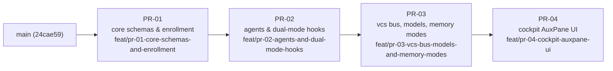

# principal-architect-plugin — Programme Plan

Companion to [`PROGRAM.md`](PROGRAM.md). This file holds the operational plan: the PR dependency graph, branch conventions, the per-PR execution and audit protocol, environment constraints, programme decisions, and the live status tracker. The Chief Architect updates it at every programme-level transition.

## 1. Stacked PR Dependency Graph



| PR | Slug | Base (branch name) | Depends on | Verification floor | Primary SPEC sections |
|---|---|---|---|---|---|
| PR-01 | `pr-01-core-schemas-and-enrollment` | `main` | — | `pytest tests/test_schemas.py tests/test_state_db_and_sync.py` | §4, §6, §8 (`enroll`, `unenroll`, `status`, `mode`) |
| PR-02 | `pr-02-agents-and-dual-mode-hooks` | `feat/pr-01-core-schemas-and-enrollment` | PR-01 | `pytest tests/test_hooks_monitored_vs_autonomous.py` | §5.2, §7, §8 (`pr approve-plan`, `wo verify`, `escalate`), §11 |
| PR-03 | `pr-03-vcs-bus-models-and-memory-modes` | `feat/pr-02-agents-and-dual-mode-hooks` | PR-02 | `pytest tests/test_github_and_local_git_bus.py tests/test_memory_modes.py` | §5.3, §8 (remaining lifecycle commands), §9 |
| PR-04 | `pr-04-cockpit-auxpane-ui` | `feat/pr-03-vcs-bus-models-and-memory-modes` | PR-03 | `pytest tests/test_cockpit_api.py` + live AuxPane verification (interactive WO) | §10 |

Execution is **serial**: a PR's Tier 2 PA is spawned only after the upstream PR has graduated (Step 6B complete) and its Charter has been refined just-in-time against the upstream PR's final exported interfaces.

## 2. Branch & Integration Conventions

1. **Work Order branches stack linearly** inside a PR: `pr-NN-<slug>/wo1-<topic>` bases on the PR's `base_branch`; `woM` bases on `wo(M-1)`. Bases are always **branch names**, never SHAs (`STACKING_REFERENCE.md` §1.2).
2. **Integration tip per PR:** at Step 6A the PA creates or fast-forwards `feat/pr-NN-<slug>` to the final WO branch (`git branch -f feat/pr-NN-<slug> pr-NN-<slug>/woM-<topic>`). Remediation commits land on the tip WO branch (or a stacked `wo(M+1)-review-remediation`) and `feat/pr-NN-<slug>` is re-fast-forwarded. The `feat/` name never changes (immutable-head rule) and is what downstream PRs base on and what `gh pr create --head` uses when a GitHub remote exists.
3. **Restacking:** when an upstream PR is amended after a downstream PR has started, the downstream PA runs `git rebase --update-refs` (or `pa pr restack` once PR-03 lands) from its WO1 onto the new upstream tip.
4. **Archiving:** abandoned branches are renamed `archive/<original-name>`.
5. **Merging to `main`:** bottom-up only. `main` is advanced by fast-forwarding or merging `feat/pr-01-…` first; never squash-merge a middle-stack branch into its parent.

## 3. Per-PR Execution, Audit & Graduation Protocol

```
Chief (Tier 1)
 ├─ 0. JIT Charter: refine & lock Part I of pr-NN/PROJECT.md; stamp charter_hash; commit on the base branch
 ├─ 1. Spawn Tier 2 PA for PR-NN (bridge prompt: Charter, PROGRAM.md, SPEC sections, constraints)
 │     PA: file-level discovery → Part II (WO breakdown) → reports decomposition to Chief
 ├─ 2. Human reviews Part II in the Chief session → approval recorded in PROJECT.md
 │     (status: APPROVED, approved_at, and a dated "decomposition approved by user" status-log line)
 │     PA: creates WO branches, writes each WORKORDER.md, spawns exactly 1 Tier 3 Worker per WO (serially,
 │         Workspace "inherit", Model mapped from `complexity`), re-ingests each Completion Report
 ├─ 3. Step 6A: PA fast-forwards feat/pr-NN-<slug>, (github mode) pushes + opens PR, reports
 │     {tip branch, head_sha, (pr_number, pr_url)} to Chief and PAUSES (no graduation)
 ├─ 4. Spawn Tier 2b Cold-Firewall Auditor (Model inherit, Workspace inherit, read-only working tree)
 │     Input: PR id + head_sha, SPEC.md, docs/, PROGRAM.md, PROJECT.md Part I/II, WORKORDER.md files
 │     Review: `git diff <base_branch>...feat/pr-NN-<slug>` (or `gh pr diff`), run the verification floor,
 │             check I1–I11 incl. the I10 hygiene search; 5 axes: spec_alignment, invariants, edge_cases,
 │             test_quality, scope_hygiene
 │     Output (local_git mode): pr-NN/AUDIT-round-K.md committed on the tip with trailer
 │             `PA-Audit-Verdict: <verdict> (<head_sha>)`; (github mode) also `gh pr review <N> --comment`
 │             Verdict header: `**Audit Verdict:** APPROVED (0 blocking, 0 major)` or
 │                             `**Audit Verdict:** CHANGES_REQUESTED (<B> blocking, <M> major, <N> minor)`
 ├─ 5. If CHANGES_REQUESTED: Chief messages PA → PA spawns a Remediation Worker → pushes fixes →
 │     posts `## Review Remediation` table → reports new head_sha → Chief messages Auditor to verify
 │     <old_sha>..<new_sha>. Loop ≤ 5 rounds (max_audit_rounds), then escalate to the user.
 ├─ 6. On APPROVED: Chief messages PA to execute Step 6B (PROJECT.md Part III, memory graduation:
 │     MEMORY.md Active → Recently Completed, MODULE_INDEX.md rows, PROJECT_INDEX.md if > 5)
 └─ 7. Chief ingests the PA session log into PROGRAM.md §3, updates this tracker, refines the next Charter
```

**Turn serialisation (shared working tree):** PA and Auditor never run concurrently. The Auditor treats the working tree as read-only.

**Model policy:** Tier 2 PA and Tier 2b Auditor are spawned with `Model: inherit` (the Chief session's frontier model). Tier 3 Workers are spawned by the PA with `Model` mapped from the WORKORDER `complexity` (`mechanical → flash_lite`, `standard → flash`, `architect → inherit`); `interactive` WOs are handed to the user via bridge prompt, never auto-spawned.

## 4. Environment Baseline & Constraints (recorded 2026-10-16)

| Aspect | Observed | Programme handling |
|---|---|---|
| Git remote | none (`git remote -v` empty); no GitHub repository exists for this project yet | `vcs_mode: local_git` for the whole programme unless the user creates a remote. Audits are committed `AUDIT-round-K.md` files; the "PR" is the `feat/` integration branch. Switching to `github` mode later only adds projection — nothing in the protocol changes. |
| External memory plugin | not enrolled (no `.memory/`, no registry entry) | `memory_mode: builtin` — the 3-file index under `memory/` is live and PAs perform full distillation. |
| Python | 3.13 on host; **no `pip`, no `ensurepip`, no `pydantic`, no `pytest`**; PyPI and `get-pip.py` reachable | PR-01 must deliver `scripts/dev-bootstrap.sh` as its first Work Order so the verification floor is executable. All pytest floors run inside `./.venv`. |
| Shell tools | `git`, `gh` (authenticated), `curl`, `sqlite3` via stdlib | Tests must mock `gh` and never touch the network. |
| PA workspace path | legacy `.agents/skills/principal-architect-workspace/` | See decision D1. |

## 5. Programme Decisions Log

| # | Decision | Rationale | Date |
|---|---|---|---|
| D1 | Bootstrap the PA workspace at the legacy path `.agents/skills/principal-architect-workspace/` rather than SPEC's `.agents/plugins/principal-architect-workspace/`. | The installed skill that Tier 2 PAs and Tier 3 Workers run under hard-codes the legacy path (Core Directive 2, spawn prompt format). PR-01's `pa enroll` ships the migration; running it against this repository after PR-01 graduates is the programme's first dogfood test. `common.workspace_dir()` must resolve both paths from PR-01 onward so tests and later PRs are path-agnostic. | 2026-10-16 |
| D2 | Each PR has a stable `feat/pr-NN-<slug>` integration branch, fast-forwarded to the final WO tip at Step 6A. | SPEC §12 names these branches; the Chief needs stable, branch-name bases for the DAG before any PA has decomposed its PR; the immutable-head rule forbids renaming a PR head later. | 2026-10-16 |
| D3 | Programme runs in `local_git` mode until the user opts into a GitHub remote. | No remote exists; SPEC I5 requires the local floor to be sufficient — exercising it on the plugin's own build is the strongest validation of that invariant. | 2026-10-16 |
| D4 | `scripts/dev-bootstrap.sh` is a PR-01 deliverable and a hard precondition for every verification floor. | Host has no `pip`; without a reproducible venv the floors are not runnable by Workers or Auditors. | 2026-10-16 |
| D5 | In-plugin `skills/principal-architect/SKILL.md`, `rules/00-pa-operating-model.md`, and `agents/*.md` belong to PR-02 (the prompt/policy layer); the `templates/*.tpl` belong to PR-01 (consumed by `pa enroll`). | Keeps PR-01 purely about contracts, state, and enrollment; PR-02 owns everything an agent reads as instruction. | 2026-10-16 |
| D6 | `pa mode` (get/set `execution_mode`) is included in PR-01. | It is a trivial `repo_config` accessor and PR-02's hook tests need it to flip modes. | 2026-10-16 |
| D7 | Plan approval flows through the Chief session: the PA reports its Part II decomposition to the Chief, the user approves in the Chief session, the PA records `status: APPROVED`, `approved_at`, and a dated approval line in `PROJECT.md` before spawning any Worker. | Matches the operating model (plan gate binds at the human → PA/Chief boundary; the Chief session *is* the human's session) and gives Workers committed provenance. Until PR-02 lands there is no hook to enforce R2, so the PA bridge prompt states this obligation explicitly. | 2026-10-16 |

## 6. Status Tracker

| PR | Charter | PA conversation | Plan approved | WOs | Step 6A tip / head_sha | Audit | Graduated |
|---|---|---|---|---|---|---|---|
| PR-01 | 🔒 locked 2026-10-16 | — (spawn pending user review) | — | — | — | — | — |
| PR-02 | stub (frontmatter only) | — | — | — | — | — | — |
| PR-03 | stub (frontmatter only) | — | — | — | — | — | — |
| PR-04 | stub (frontmatter only) | — | — | — | — | — | — |

## 7. Risks & Mitigations

| Risk | Mitigation |
|---|---|
| Hash algorithm implemented by PR-01 diverges from the Charter's normative definition, invalidating the pre-stamped `charter_hash`. | The algorithm is fixed in `PROGRAM.md` §2.2(5) and PR-01's Charter; `tests/test_schemas.py` must assert `verify_charter_hash()` on the committed PR-01 `PROJECT.md`. If a genuine defect in the definition is found, the PA escalates and the Chief re-stamps. |
| Worker scope creep across the shared `pa_cli.py` / `schemas.py` in later PRs. | Additive-only rule in `PROGRAM.md` §2.1; auditor checks `scope_hygiene` against `allowed_modules`. |
| Auditor false negatives on hygiene (I10). | Auditor runs an explicit repository-wide text search for machine paths and internal identifiers every round. |
| Toolchain bootstrap fails for Workers on a different host. | `dev-bootstrap.sh` must support three strategies (uv / venv / get-pip) and print actionable diagnostics; its own smoke test is part of PR-01's WO1 verification. |
