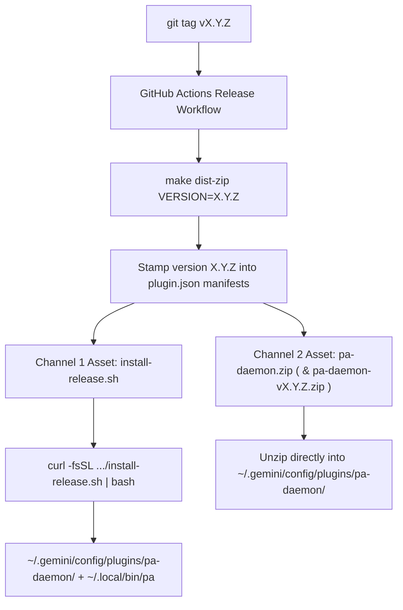

# Plugin Packaging, Distribution & Versioning Guide (`principal-architect`)

> **Scope:** Canonical architecture and implementation blueprint for packaging, distributing, and maintaining versions of the **Principal Architect** Antigravity plugin (`pa-daemon` + `workspace-plugin/principal-architect`), an **Archetype B (Interpreted Python Script)** plugin, alongside how it contrasts with **Archetype A (Compiled Binary)** plugins such as `repo-memory`.

---

## 1. Executive Summary

A production Antigravity plugin that combines a UI/AuxPane sidecar (`sidecar.json`), workspace lifecycle hooks (`hooks.json`), custom role subagents (`agents/`), workspace rules (`rules/`), and slash-command skills (`skills/`) faces three packaging constraints:

1. **Global vs. Per-Workspace Isolation:** UI and scheduled sidecars (`sidecar.json`) only launch from global plugins under `~/.gemini/config/plugins/<daemon-name>/`, whereas governance lifecycle hooks (`PreInvocation`, `PreToolUse`, `PostToolUse`, `Stop`) and role subagents (`pa-chief-architect`, `pa-principal-architect`, `pa-engineer`, `pa-auditor`, `pa-debugger`) must only fire inside **explicitly enrolled repositories** (`<repo>/.agents/plugins.json`) so unenrolled workspaces experience zero hook overhead.
2. **Machine-Specific Path Resolution:** Antigravity's configuration loaders apply different path-expansion rules across `.agents/plugins.json`, `hooks.json`, `sidecar.json`, and `SKILL.md`. Naive zipping of an installed plugin directory captures hardcoded `/Users/<author>/...` paths or unversioned runtime state (`state/registry.json`) that break on another user's machine.
3. **Python Runtime & Dependency Portability vs. Zero-CLI Drop-In Bundles:** While `principal-architect`'s hot-path hooks (`common.py`, `state_db.py`, `pre_invocation.py`, `post_tool_receipt.py`) and the `cockpit.py` HTTP server are 100% Python standard library, slow-path schema validation (`schemas.py`, `models.py`, `pre_tool_gate.py`, `stop_gate.py`, and `pa_cli.py`) requires `pydantic>=2,<3` and `pyyaml>=6`. Users want either a one-command CLI installer **or** a single universal `.zip` (`pa-daemon.zip`) they can extract directly into `~/.gemini/config/plugins/`.

This document defines the **Dual-Channel Distribution & Single-Source Versioning Architecture** tailored for `principal-architect-plugin`.

---

## 2. Core Architectural Principles

### 2.1 The Two-Plugin Packaging Split (`pa-daemon` + `workspace-plugin/principal-architect`)

`principal-architect` uses a **single installation directory** under `~/.gemini/config/plugins/pa-daemon/` containing two distinct plugin manifests:

```text
~/.gemini/config/plugins/pa-daemon/                  # 1. Global Daemon Plugin (discovered at IDE startup)
├── plugin.json                                      #    name: "pa-daemon", version: "<semver>"
├── config.json                                      #    { "enabled": true }
├── bin/                                             #    Portable CLI & hook wrappers
│   ├── pa                                           #    Wrapper script -> pa_cli.py (auto-selects venv/python3)
│   └── run-pa-hook.sh                               #    Fail-open + macOS quarantine-stripping hook wrapper
├── sidecars/
│   └── pa_cockpit/
│       ├── sidecar.json                             #    Global AuxPane + Sidebar UI sidecar (cockpit.py)
│       └── ui/                                      #    Cockpit frontend (index.html, app.js, styles.css, preload.js)
├── skills/
│   └── principal-architect-admin/
│       └── SKILL.md                                 #    Global /principal-architect-admin skill (enroll, status, doctor, mode)
├── state/                                           #    Runtime-only local registry (excluded from .zip; preserved on upgrade)
│   └── registry.json                                #    Enrolled repositories map & active selection
└── workspace-plugin/                                # 2. Nested Workspace Bundle (ignored by global scanner)
    └── principal-architect/
        ├── plugin.json                              #    name: "principal-architect", version: "<semver>"
        ├── hooks.json                               #    PreInvocation, PreToolUse, PostToolUse, Stop
        ├── agents/                                  #    Tier 1/2/3 subagents (pa-chief-architect, pa-principal-architect,
        │                                            #    pa-engineer, pa-auditor, pa-debugger)
        ├── rules/                                   #    Workspace operating model (00-pa-operating-model.md)
        ├── skills/
        │   └── principal-architect/
        │       ├── SKILL.md                         #    Core workflow skill
        │       ├── references/                      #    Tier playbooks & schemas
        │       └── templates/                       #    PROGRAM.md, PROJECT.md, WORKORDER.md, AUDIT.md templates
        └── scripts/                                 #    Control-plane CLI, hooks, SQLite state, and Cockpit server
            ├── pa_cli.py
            ├── cockpit.py
            ├── pre_invocation.py
            ├── pre_tool_gate.py
            ├── post_tool_receipt.py
            ├── stop_gate.py
            └── ...
```

**Why this works:**
- Global plugin discovery scans `~/.gemini/config/plugins/` strictly **one level deep**. It discovers `pa-daemon` (starting the `pa_cockpit` UI sidecar and registering the global `/principal-architect-admin` management skill) and completely ignores `workspace-plugin/principal-architect/`.
- When a user enrolls a repository (via `/principal-architect-admin enroll this repo` or `pa enroll`), `pa_cli.py` writes the resolved **absolute path** of `workspace-plugin` into `<repo>/.agents/plugins.json` (and adds `.agents/plugins.json` to `<repo>/.git/info/exclude`).
- Only enrolled repositories load `workspace-plugin/principal-architect/hooks.json`, `agents/`, `rules/`, and `skills/principal-architect/`.

### 2.2 In-Place Replaceable Plugin Directory & Preserved State

The directory `~/.gemini/config/plugins/pa-daemon/` must be safe to overwrite in-place on upgrade:
- **Repository-shared state** belongs in `<repo>/.agents/plugins/principal-architect-workspace/` (`PROGRAM.md`, `PROJECT.md`, `WORKORDER.md`, `AUDIT-round-*.md`, `memory/`), tracked in Git.
- **Repository-local derived state** belongs in `<repo>/.agents/plugins/principal-architect-workspace/.state/` (`state.db`, `pa-skills.json`, `pa-worker-rules.json`), ignored by Git and rebuildable via `pa sync`.
- **Machine-local enrolled repo registry** lives in `~/.gemini/config/plugins/pa-daemon/state/registry.json`.
  - Release `.zip` bundles **never** include `state/` or `__pycache__/`, so extracting `pa-daemon.zip` over `~/.gemini/config/plugins/pa-daemon/` updates all code, UI assets, agents, skills, and manifests in-place without clobbering `state/registry.json`.
  - `scripts/install.sh` and `scripts/install-release.sh` back up `state/`, update files **in-place** (never deleting the top-level `pa-daemon` directory inode while Antigravity is running), and restore `state/`.

### 2.3 Two Plugin Archetypes Compared

| Dimension | Archetype A: Compiled Binary (`repo-memory`) | Archetype B: Interpreted Script (`principal-architect`) |
|---|---|---|
| **Runtime** | Single static Go binary (`CGO_ENABLED=0`) | Python 3.11+ (`pydantic>=2,<3`, `pyyaml>=6`) |
| **Source of plugin files** | Embedded in binary via `//go:embed` (`packaging/antigravity/templates.go`) | Committed directory tree (`daemon/`) in source repo |
| **Platform matrix** | 5 OS/Arch binaries & zips (`darwin-arm64`, `darwin-amd64`, `linux-amd64`, `linux-arm64`, `windows-amd64`) | **1 Universal bundle** (`pa-daemon.zip`, platform-independent) |
| **CLI entry point** | `~/.local/bin/repo-memory` -> `~/.gemini/config/plugins/repo-memory-daemon/bin/repo-memory` | `~/.local/bin/pa` -> `~/.gemini/config/plugins/pa-daemon/bin/pa` |
| **Sidecar type** | Scheduled sidecar (`builtin: "schedule"`, runs `tick`) | Process / Web UI sidecar (`command: "python3"`, runs `cockpit.py`) |

---

## 3. Platform Path-Resolution Mechanics & Gotchas

To build a universal `pa-daemon.zip` bundle and CLI installer that work on **any** user's machine without hardcoded `/Users/<author>` paths, every configuration file must follow the exact path-expansion rules of the surface that loads it:

| Surface | File Path | Expands `~`? | Expands `$HOME` / Env Vars? | Expands `${PLUGIN_ROOT}`? | Portable Pattern for `principal-architect` |
|---|---|---|---|---|---|
| **Workspace Plugin Pointer** | `<repo>/.agents/plugins.json` | **NO** | **NO** | **NO** | Never distribute statically. Generated on the user's machine at `pa enroll` time using `Path.home()` / `.resolve()`. |
| **Lifecycle Hooks** | `workspace-plugin/principal-architect/hooks.json` | **YES** (`expandHome`) | **YES** (runs via `/bin/sh -c` on Unix) | **NO** (unless fallback set in command string) | `"command": "~/.gemini/config/plugins/pa-daemon/bin/run-pa-hook.sh pre_invocation.py"` |
| **Process / UI Sidecar** | `sidecars/pa_cockpit/sidecar.json` (`command: ...`) | **NO** | **NO** | **YES** | `"command": "python3", "args": ["${PLUGIN_ROOT}/workspace-plugin/principal-architect/scripts/cockpit.py"]` |
| **Admin Skill** | `skills/principal-architect-admin/SKILL.md` | **YES** (Bash tool) | **YES** (Bash tool) | **NO** | `~/.gemini/config/plugins/pa-daemon/bin/pa` (with `~/.local/bin/pa` symlinked for terminal CLI use) |

### Critical Platform Gotchas

1. **In-Memory Plugin Path Caching (Never `rm -rf` the Top-Level Plugin Root):**
   When Antigravity starts, it caches discovered global plugin root directories in memory and sets `cwd` to that path when invoking hooks or sidecars. Never delete or rename the top-level `~/.gemini/config/plugins/pa-daemon` directory while the IDE is running; overwrite subdirectories in-place so running sessions never hit `chdir: no such file or directory`.
2. **`PreToolUse` Implicit Deny:**
   In Antigravity, returning `{}` or an empty stdout on `PreToolUse` causes the host to fail-closed and block tool execution. If `python3` or a script fails unexpectedly during an upgrade, `bin/run-pa-hook.sh` traps the failure and returns `{"decision":"allow"}` for `pre_tool_gate.py`.
3. **Python Environment & Third-Party Dependencies (`pydantic`, `pyyaml`):**
   - `cockpit.py` (the UI sidecar) and fast-exit hook paths (`common.py`, `state_db.py`, `pre_invocation.py`, `post_tool_receipt.py`) use **only** the Python standard library so they launch anywhere with zero external packages.
   - `pa_cli.py`, `pre_tool_gate.py` (when validating schemas), and `stop_gate.py` require `pydantic>=2,<3` and `pyyaml>=6`.
   - `bin/pa` and `bin/run-pa-hook.sh` automatically select the best Python interpreter in priority order:
     1. `$PA_DAEMON_HOME/.venv/bin/python3` (managed plugin venv created by `install.sh` / `pa doctor --fix`)
     2. System `python3` on `$PATH`
4. **macOS Gatekeeper Quarantine (`com.apple.quarantine`) on Browser Downloads:**
   When a macOS user downloads `pa-daemon.zip` in a browser (Chrome/Safari) and extracts it with Finder/Archive Utility, macOS attaches `com.apple.quarantine` to executable scripts inside `bin/`.
   - **Mitigation:** `bin/run-pa-hook.sh`, `bin/pa`, and `scripts/install*.sh` automatically run `xattr -dr com.apple.quarantine` on macOS when present.

---

## 4. Dual-Channel Distribution Design

Every release (`git tag vX.Y.Z`) publishes **both channels** from a single build pipeline:



### Channel 1: Developer & Release CLI Installers (`install.sh` / `install-release.sh`)

1. **Local Checkout / Developer Install (`./scripts/install.sh` or `make install`):**
   - Computes `VERSION` from `git describe --tags --always --dirty` (stripping leading `v`).
   - Preserves `~/.gemini/config/plugins/pa-daemon/state/registry.json`, copies `daemon/` in-place into `~/.gemini/config/plugins/pa-daemon/`, strips `__pycache__`, and stamps `VERSION` into both `plugin.json` files.
   - Provisions or verifies `pydantic` and `pyyaml` (creating `~/.gemini/config/plugins/pa-daemon/.venv` if system `python3` lacks them).
   - Symlinks `~/.local/bin/pa` $\rightarrow$ `~/.gemini/config/plugins/pa-daemon/bin/pa`.
2. **Zero-Clone Release Install (`curl -fsSL https://raw.githubusercontent.com/matthewmcneill/principal-architect-plugin/main/scripts/install-release.sh | bash`):**
   - Downloads `pa-daemon.zip` from GitHub Releases into a temporary file.
   - Extracts in-place into `~/.gemini/config/plugins/pa-daemon/` while preserving `state/registry.json`.
   - Ensures `pydantic` and `pyyaml` are available (provisioning `~/.gemini/config/plugins/pa-daemon/.venv` if needed) and links `~/.local/bin/pa`.

### Channel 2: Ready-to-Unzip Universal Plugin Bundle (`pa-daemon.zip`)

For users who want to download a single `.zip` file from GitHub Releases and extract it directly into `~/.gemini/config/plugins/`:

#### Archive Layout (`pa-daemon.zip`)

Unzipping inside `~/.gemini/config/plugins/` produces `~/.gemini/config/plugins/pa-daemon/`:

```text
pa-daemon/
├── plugin.json                                      # {"name": "pa-daemon", "version": "X.Y.Z", ...}
├── config.json                                      # {"enabled": true}
├── bin/
│   ├── pa                                           # Portable CLI wrapper (chmod 0755)
│   └── run-pa-hook.sh                               # Portable hook wrapper (chmod 0755)
├── sidecars/
│   └── pa_cockpit/
│       ├── sidecar.json
│       └── ui/
│           ├── index.html
│           ├── app.js
│           ├── styles.css
│           └── preload.js
├── skills/
│   └── principal-architect-admin/
│       └── SKILL.md
└── workspace-plugin/
    └── principal-architect/
        ├── plugin.json                              # {"name": "principal-architect", "version": "X.Y.Z", ...}
        ├── hooks.json
        ├── agents/
        │   ├── pa-auditor.md
        │   ├── pa-chief-architect.md
        │   ├── pa-debugger.md
        │   ├── pa-engineer.md
        │   └── pa-principal-architect.md
        ├── rules/
        │   └── 00-pa-operating-model.md
        ├── skills/
        │   └── principal-architect/
        │       ├── SKILL.md
        │       ├── references/
        │       └── templates/
        └── scripts/
            ├── pa_cli.py
            ├── cockpit.py
            ├── pre_invocation.py
            ├── pre_tool_gate.py
            ├── post_tool_receipt.py
            ├── stop_gate.py
            └── ...
```

#### Portable CLI & Hook Wrappers (`daemon/bin/pa` and `daemon/bin/run-pa-hook.sh`)

1. **`daemon/bin/pa`**:
   - Resolves its own physical location (following symlinks when invoked via `~/.local/bin/pa`) to locate `PA_DAEMON_HOME`.
   - Strips macOS `com.apple.quarantine` on first run if present.
   - Selects `${PA_DAEMON_HOME}/.venv/bin/python3` if present, else `python3`, and `exec`s `workspace-plugin/principal-architect/scripts/pa_cli.py "$@"`.
   - Also ensures `~/.local/bin/pa` is symlinked if `~/.local/bin` is writable and `pa` is not yet linked there.

2. **`daemon/bin/run-pa-hook.sh`**:
   - Resolves `PA_DAEMON_HOME` and `PLUGIN_ROOT` dynamically relative to `$(dirname "$0")/..`.
   - Selects `${PA_DAEMON_HOME}/.venv/bin/python3` if present, else `python3`.
   - If the target script or Python interpreter is missing during an upgrade, fails open with `{"decision":"allow","reason":"fail-open: hook runtime unavailable"}` on `pre_tool_gate.py` and `{}` on other hooks so the IDE session never blocks.

---

## 5. Versioning & Upgrade Architecture

### 5.1 Single Source of Truth (`Git Tag` $\rightarrow$ `plugin.json` $\rightarrow$ `pa --version`)

1. **Git Tag is Canonical:**
   Releases are tagged with semantic versions (`v0.1.0`, `v0.2.0`, etc.). During local development builds without an exact tag, `git describe --tags --always --dirty` produces a traceable version string (e.g., `0.1.0-14-g8f3a1b2`).
2. **Dynamic Manifest Stamping:**
   `scripts/install.sh` and `make dist-zip` stamp the resolved `VERSION` into both `pa-daemon/plugin.json` and `pa-daemon/workspace-plugin/principal-architect/plugin.json`.
3. **Runtime Version Resolution (`pa --version` & `pa doctor`):**
   `pa_cli.py` reads the version from its co-located `workspace-plugin/principal-architect/plugin.json` and compares it against the installed `~/.gemini/config/plugins/pa-daemon/plugin.json`.

### 5.2 The Three Version Planes

| Plane | Where Stored | Format | Upgrade Behavior |
|---|---|---|---|
| **1. Plugin & CLI Version** | `pa-daemon/plugin.json`, `workspace-plugin/principal-architect/plugin.json` | SemVer (`0.2.0`) | Updated on every release. Checked by `pa doctor` and `pa status` to detect checkout vs. installed-daemon drift. |
| **2. Committed Workspace Schema** | `PROGRAM.md`, `PROJECT.md`, `WORKORDER.md` YAML frontmatter | Pydantic v2 models (`schemas.py`) | Backward-compatible defaults; legacy `.agents/skills/principal-architect-workspace/` migrated via `pa migrate` / `pa enroll --migrate`. |
| **3. Local SQLite Control-Plane State** | `<repo>/.agents/plugins/principal-architect-workspace/.state/state.db` | SQLite (`SCHEMA_VERSION` in `state_db.py`) | Idempotent additive column migrations on open (`_ensure_column`); 100% rebuildable from committed Markdown specs and Git trailers via `pa sync`. |

### 5.3 Diagnostics & Drift Detection (`pa doctor` and `pa status`)

Running `pa doctor [path]` verifies the complete installation and workspace health:
1. **CLI vs. Installed Daemon Version:** Compares the running script's `plugin.json` version against `~/.gemini/config/plugins/pa-daemon/plugin.json`. Warns if they differ (`Run ./scripts/install.sh to refresh pa-daemon`).
2. **Python Runtime & Dependencies:** Verifies Python `>= 3.11` and imports `pydantic` and `pyyaml`. If `--fix` is passed and dependencies are missing, automatically provisions `~/.gemini/config/plugins/pa-daemon/.venv`.
3. **Global Daemon & Sidecar:** Verifies `~/.gemini/config/plugins/pa-daemon/config.json` (`enabled: true`) and `sidecars/pa_cockpit/sidecar.json`.
4. **Enrolled Repository Health:** Checks `state/registry.json` entries and verifies that each enrolled repository's `.agents/plugins.json` points to the existing `workspace-plugin` path.

### 5.4 Atomic Upgrades Across Enrolled Repositories

Because every enrolled repository's `.agents/plugins.json` points to the stable path:
```json
{
  "entries": [
    {
      "path": "/Users/<user>/.gemini/config/plugins/pa-daemon/workspace-plugin"
    }
  ]
}
```
upgrading `~/.gemini/config/plugins/pa-daemon/` (via `./scripts/install.sh`, `install-release.sh`, or unzipping a new `pa-daemon.zip`) **atomically upgrades all enrolled repositories on the machine** without touching `<repo>/.agents/plugins.json` or re-enrolling.

---

## 6. User Experience Comparison

| Workflow | Install Command / Action | Upgrade Command / Action | Enrolling a Repo |
|---|---|---|---|
| **Option A: Drop-In `.zip` (Zero CLI)** | Download `pa-daemon.zip` from GitHub Releases and unzip into `~/.gemini/config/plugins/` (yielding `~/.gemini/config/plugins/pa-daemon/`), then restart Antigravity. | Unzip newer `pa-daemon.zip` over `~/.gemini/config/plugins/pa-daemon/` and restart Antigravity. | In chat: `/principal-architect-admin enroll this repo` |
| **Option B: Source / CLI (`install.sh`)** | `./scripts/install.sh` (or `make install`) | `git pull && make install` | In chat: `/principal-architect-admin enroll this repo` or CLI: `pa enroll .` |
| **Option C: Release One-Liner** | `curl -fsSL https://raw.githubusercontent.com/matthewmcneill/principal-architect-plugin/main/scripts/install-release.sh \| bash` | Re-run the one-liner | In chat: `/principal-architect-admin enroll this repo` or CLI: `pa enroll .` |
